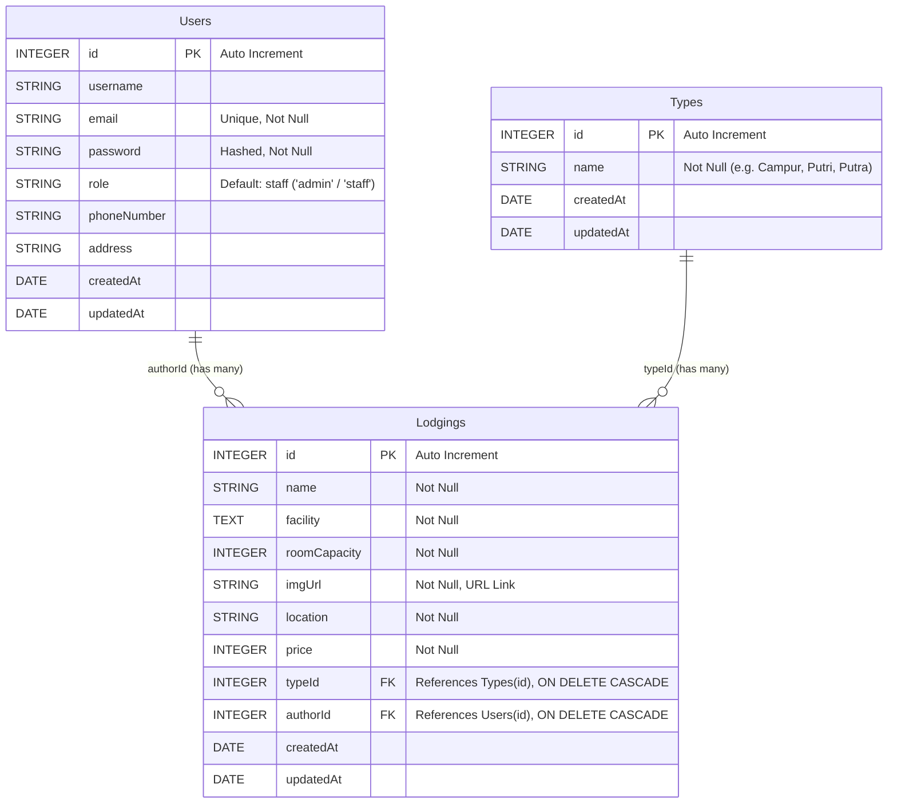

# Papi Kos (Papi Kos) - Platform Persewaan & Manajemen Indekos

Aplikasi web *full-stack* modern untuk sistem persewaan dan pengelolaan kamar indekos (**Papi Kos / Papi Kos**). Proyek ini terdiri dari arsitektur backend RESTful API terpusat berbasis Node.js & PostgreSQL, serta dua aplikasi frontend berbasis React.js & Vite (satu portal untuk publik/pencari kos, dan satu portal CMS untuk pengelola indekos).

---

## Daftar Isi
1. [Tentang Aplikasi](#tentang-aplikasi)
2. [Technology Stack](#technology-stack)
3. [Daftar Library & Dependensi](#daftar-library--dependensi)
4. [Arsitektur & Struktur Direktori](#arsitektur--struktur-direktori)
5. [Skema Database & Relasi](#skema-database--relasi)
6. [Dokumentasi API yang Tersedia](#dokumentasi-api-yang-tersedia)
   - [Respon Error Global](#respon-error-global)
   - [Matriks Hak Akses](#matriks-hak-akses-role-matrix)
   - [Endpoints Publik](#endpoints-publik)
   - [Endpoints Terproteksi (CMS / Back-Office)](#endpoints-terproteksi-cms--back-office)
7. [Panduan Setup & Instalasi](#panduan-setup--instalasi)
8. [Cara Menjalankan Aplikasi](#cara-menjalankan-aplikasi)
9. [Cara Menguji Aplikasi (Testing)](#cara-menguji-aplikasi-testing)

---

## Tentang Aplikasi

**Papi Kos** dirancang untuk memudahkan interaksi antara pemilik/pengelola indekos dan para calon penyewa secara efisien melalui platform digital yang responsif:

### 1. Public Site (`app/public/`)
Ditujukan bagi calon penyewa atau pengunjung umum untuk mencari kamar kos idaman:
- **Katalog Kos Interaktif:** Menampilkan kartu (*card*) indekos lengkap dengan foto, nama, lokasi, harga, fasilitas, dan kapasitas kamar.
- **Pencarian Real-Time (*Search*):** Mencari kamar kos berdasarkan nama kos.
- **Penyaringan (*Filter*):** Memfilter kos berdasarkan tipe penghuni: *Campur*, *Putri*, atau *Putra*.
- **Pengurutan (*Sorting*):** Mengurutkan data berdasarkan harga termurah atau termahal.
- **Paginasi Data (*Pagination*):** Pembagian tampilan data per halaman agar waktu muat lebih cepat dan pengalaman pengguna lebih nyaman.
- **Halaman Detail:** Informasi komprehensif mengenai fasilitas, kapasitas, alamat lengkap, dan harga kos yang dipilih.

### 2. CMS Portal (`app/cms/`)
Ditujukan bagi **Admin** dan **Staff** untuk mengelola seluruh data operasional kos:
- **Autentikasi Terproteksi:** Halaman login berbasis JSON Web Token (JWT) dengan penyimpanan token lokal (`localStorage`).
- **Manajemen Kos (CRUD):** Tambah kamar kos baru, melihat daftar seluruh kos, mengedit data kos, serta menghapus data kos.
- **Otorisasi Berbasis Kepemilikan (*Ownership Authorization*):** Staff hanya dapat mengedit dan menghapus kamar kos milik akunnya sendiri, sedangkan Admin memiliki kendali penuh atas semua kamar kos.
- **Upload Gambar Terintegrasi:** Mengubah foto kos secara langsung dengan mengunggah file gambar ke cloud storage ImageKit melalui *memory buffer* Multer.
- **Pendaftaran Staff Baru:** Fitur eksklusif bagi Admin untuk mendaftarkan akun staff baru ke dalam sistem.
- **Manajemen Tipe Kos:** Melihat dan memperbarui daftar kategori/tipe kos.

### 3. RESTful API Server (`server/`)
Layanan backend terpusat yang menangani manipulasi basis data PostgreSQL melalui Sequelize ORM, penegakan aturan bisnis, validasi masukan data, otentikasi JWT, otorisasi role, dan integrasi dengan layanan penyimpanan berkas ImageKit.

---

## Technology Stack

| Layer / Kategori | Teknologi | Kegunaan |
| :--- | :--- | :--- |
| **Backend Runtime** | Node.js (CommonJS) | Lingkungan eksekusi JavaScript sisi server |
| **Backend Framework** | Express.js (v5.x) | Web framework minimalis dan cepat untuk REST API |
| **Database** | PostgreSQL | Sistem manajemen basis data relasional (RDBMS) |
| **ORM** | Sequelize (v6.x) & Sequelize CLI | Object-Relational Mapper & alat bantu migrasi skema |
| **Frontend Framework** | React.js (v19.x) | Library deklaratif untuk membangun antarmuka pengguna SPA |
| **Frontend Tooling** | Vite (v8.x) | Build tool & bundler modern berkinerja tinggi |
| **Client-Side Routing** | React Router (v8.x) | Sistem navigasi halaman tanpa reload (*Single Page Application*) |
| **Styling & CSS** | Tailwind CSS (v4.x) | Utility-first CSS framework untuk antarmuka responsif |
| **Security & Auth** | JWT (`jsonwebtoken`) & `bcryptjs` | Otentikasi berbasis token dan hashing sandi satu arah |
| **Cloud Media Storage**| ImageKit (`@imagekit/nodejs`) | Manajemen dan CDN penyimpanan foto kos di cloud |
| **Testing Suite** | Jest & Supertest | Automated testing framework dan HTTP assertion untuk TDD |

---

## Daftar Library & Dependensi

### 1. Dependensi Server (`server/package.json`)

#### Production Dependencies
- **`express` (`^5.2.1`):** Menangani perutean HTTP, request lifecycle, middleware, dan pengembalian respons JSON.
- **`sequelize` (`^6.37.8`):** Mengelola model data, relasi antar entitas, query database, serta validasi data sebelum disimpan.
- **`pg` (`^8.23.0`):** Driver PostgreSQL resmi untuk menghubungkan Sequelize dengan server database.
- **`bcryptjs` (`^3.0.3`):** Membuat salt dan hash aman untuk kata sandi user serta memverifikasi kecocokan sandi saat login.
- **`jsonwebtoken` (`^9.0.3`):** Menghasilkan JWT access token saat login dan memvalidasi keabsahan token pada request terproteksi.
- **`cors` (`^2.8.6`):** Mengizinkan aplikasi client (Frontend) berkomunikasi lintas domain/port dengan server API.
- **`dotenv` (`^17.4.2`):** Memuat variabel konfigurasi dari berkas `.env` ke dalam `process.env`.
- **`multer` (`^2.2.0`):** Menangani unggahan file berformat `multipart/form-data` ke dalam memori RAM (*memoryStorage*).
- **`@imagekit/nodejs` (`^7.11.0`):** SDK resmi ImageKit untuk mengunggah file buffer dari server ke penyimpanan cloud ImageKit.
- **`axios` (`^1.20.0`):** HTTP client berbasis Promise untuk komunikasi HTTP eksternal.
- **`ejs` (`^6.0.1`):** Template engine server-side jika diperlukan rendering HTML dari server.

#### Development Dependencies
- **`jest` (`^30.4.2`):** Test runner otomatis untuk menjalankan unit test dan integration test.
- **`supertest` (`^7.2.2`):** Mengirim simulasi request HTTP ke instance aplikasi Express untuk pengujian endpoint secara otomatis.
- **`sequelize-cli` (`^6.6.5`):** Baris perintah untuk mengeksekusi migrasi tabel dan seeding data awal.

---

### 2. Dependensi Client CMS & Public (`app/cms/` & `app/public/`)

- **`react` & `react-dom` (`^19.2.8`):** Pustaka utama perenderan antarmuka berbasis komponen reaktif.
- **`react-router` (`^8.3.1`):** Komponen perutean deklaratif (`BrowserRouter`, `Routes`, `Route`, `Link`, `useNavigate`, `useParams`).
- **`tailwindcss` & `@tailwindcss/vite` (`^4.3.3`):** Pustaka utilitas CSS modern yang diintegrasikan langsung ke Vite pipeline.
- **`axios` (`^1.20.0`):** Melakukan request HTTP asynchronous (`GET`, `POST`, `PUT`, `PATCH`, `DELETE`) ke backend API.
- **`toastify-js` (`^1.12.0`):** Menampilkan notifikasi *toast popup* (sukses/gagal) saat aksi pengguna selesai diproses.
- **`vite` (`^8.2.2`):** Server pengembangan lokal cepat dengan fitur *Hot Module Replacement* (HMR).
- **`eslint`:** Linter untuk menjaga standar kualitas kode JavaScript dan aturan React Hooks.

---

## Arsitektur & Struktur Direktori

Proyek ini menerapkan arsitektur **multi-package / layered architecture** yang memisahkan kode server dan antarmuka client secara independen.

### Struktur Berkas Lengkap

```text
papikos/
├── app/                                  # Direktori aplikasi Frontend
│   ├── cms/                              # Aplikasi CMS (Portal Pengelola/Admin/Staff)
│   │   ├── src/
│   │   │   ├── components/
│   │   │   │   ├── constant/
│   │   │   │   │   └── baseUrl.js        # Konfigurasi URL dasar server API
│   │   │   │   ├── form/
│   │   │   │   │   └── FormLodging.jsx   # Form reusable untuk Create dan Update lodging
│   │   │   │   ├── layout/
│   │   │   │   │   └── BaseLayout.jsx    # Kerangka layout terproteksi (Sidebar + Content)
│   │   │   │   ├── navbar/
│   │   │   │   │   └── Navbar.jsx        # Komponen navigasi atas
│   │   │   │   └── sidebar/
│   │   │   │       └── Sidebar.jsx       # Menu navigasi samping
│   │   │   ├── pages/
│   │   │   │   ├── AddUserPage.jsx       # Halaman pendaftaran staff baru (Admin only)
│   │   │   │   ├── CreatePage.jsx        # Halaman tambah kamar kos baru
│   │   │   │   ├── LodgingPage.jsx       # Halaman tabel seluruh kamar kos
│   │   │   │   ├── LoginPage.jsx         # Halaman masuk sistem CMS
│   │   │   │   ├── NotFound.jsx          # Tampilan error 404
│   │   │   │   ├── TypePage.jsx          # Halaman tabel tipe/kategori kos
│   │   │   │   ├── UpdatePage.jsx        # Halaman edit data kamar kos
│   │   │   │   └── UploadPage.jsx        # Halaman upload/ganti foto kos via ImageKit
│   │   │   ├── App.jsx                   # Konfigurasi router aplikasi CMS
│   │   │   ├── index.css                 # Import Tailwind CSS
│   │   │   └── main.jsx                  # Entry point React DOM
│   │   ├── package.json
│   │   └── vite.config.js
│   │
│   ├── public/                           # Aplikasi Publik (Customer Facing Site)
│   │   ├── src/
│   │   │   ├── components/
│   │   │   │   ├── card/
│   │   │   │   │   └── Card.jsx          # Kartu display rincian kos
│   │   │   │   ├── constant/
│   │   │   │   │   └── baseUrl.js        # Konfigurasi URL dasar server API
│   │   │   │   ├── layout/
│   │   │   │   │   └── BaseLayout.jsx    # Kerangka layout publik (Navbar + Outlet)
│   │   │   │   └── navbar/
│   │   │   │       └── Navbar.jsx        # Navigasi publik dengan tombol pencarian
│   │   │   ├── pages/
│   │   │   │   ├── Lodgings.jsx          # Katalog kos, pencarian, filter, sorting & pagination
│   │   │   │   ├── LodgingDetail.jsx     # Detail lengkap kos terpilih
│   │   │   │   └── NotFound.jsx          # Halaman 404
│   │   │   ├── App.jsx                   # Konfigurasi router aplikasi publik
│   │   │   ├── index.css                 # Import Tailwind CSS
│   │   │   └── main.jsx                  # Entry point React DOM
│   │   ├── package.json
│   │   └── vite.config.js
│   ├── package.json
│   ├── README.md
│   └── TODO.md
│
├── server/                               # Direktori Backend RESTful API
│   ├── bin/
│   │   └── www.js                        # HTTP server runner pada PORT yang ditentukan
│   ├── config/
│   │   └── config.json                   # Konfigurasi database PostgreSQL (dev, test, prod)
│   ├── controllers/
│   │   ├── authController.js             # Logika otentikasi (login) dan registrasi user
│   │   ├── lodgingController.js          # Logika CRUD lodging, upload gambar, dan public read
│   │   └── typeController.js             # Logika CRUD tipe kos
│   ├── data/
│   │   ├── lodgings.json                 # Data awal JSON untuk seeding Lodgings
│   │   ├── types.json                    # Data awal JSON untuk seeding Types
│   │   └── users.json                    # Data awal JSON untuk seeding Users
│   ├── helpers/
│   │   ├── bcrypt.js                     # Utilitas enkripsi dan komparasi password
│   │   └── jwt.js                        # Utilitas penandatanganan dan verifikasi JWT
│   ├── middlewares/
│   │   ├── authentication.js             # Verifikasi token JWT dan ekstrak loginInfo
│   │   ├── authorization.js              # Pengecekan izin role Admin vs Staff (Ownership)
│   │   └── errorHandler.js               # Handler error terpusat untuk response standar
│   ├── migrations/
│   │   ├── 20260826074705-create-user.js    # DDL tabel Users
│   │   ├── 20260826074854-create-type.js    # DDL tabel Types
│   │   └── 20260826075213-create-lodging.js # DDL tabel Lodgings
│   ├── models/
│   │   ├── index.js                      # Inisialisasi koneksi Sequelize & loader model
│   │   ├── lodging.js                    # Model & validasi Lodging
│   │   ├── type.js                       # Model & validasi Type
│   │   └── user.js                       # Model & validasi User
│   ├── routers/
│   │   ├── index.js                      # Root router, endpoint public, dan auth
│   │   ├── lodging.js                    # Sub-router lodging terproteksi
│   │   └── type.js                       # Sub-router tipe kos terproteksi
│   ├── seeders/
│   │   ├── 20260826094846-seed-Users.js     # Seeder data pengguna awal
│   │   ├── 20260826094859-seed-Types.js     # Seeder tipe kos awal
│   │   └── 20260826094910-seed-Lodgings.js  # Seeder daftar kos awal
│   ├── utils/
│   │   └── multer.js                     # Konfigurasi Multer memory storage
│   ├── __tests__/                        # Test suite TDD dengan Jest & Supertest
│   │   ├── user.test.js
│   │   ├── readPub.test.js
│   │   ├── readPubById.test.js
│   │   ├── createLodging.test.js
│   │   ├── updateLodging.test.js
│   │   └── deleteLodging.test.js
│   ├── .env                              # Variabel lingkungan rahasia
│   ├── env-template.txt                  # Contoh variabel lingkungan
│   ├── app.js                            # Konfigurasi instance Express & middleware global
│   ├── package.json
│   └── README.md
└── README.md                             # Berkas dokumentasi utama proyek
```

### Konvensi Penamaan & Struktur File
- **React Components & Pages:** Menggunakan format `PascalCase` dengan ekstensi `.jsx` (misal: `LodgingPage.jsx`, `FormLodging.jsx`).
- **Controllers & Helpers:** Menggunakan format `camelCase` dengan ekstensi `.js` (misal: `lodgingController.js`, `authController.js`, `bcrypt.js`).
- **Models:** Menggunakan nama singular huruf kecil (misal: `user.js`, `lodging.js`, `type.js`).
- **Database Migrations & Seeders:** Menggunakan format penamaan bawaan Sequelize CLI: `YYYYMMDDHHMMSS-<deskripsi>.js`.
- **API Routers:** Menggunakan nama entitas huruf kecil (misal: `lodging.js`, `type.js`).

---

## Skema Database & Relasi

Aplikasi menggunakan basis data relasional **PostgreSQL** dengan 3 entitas utama yang saling terhubung:

### Entity Relationship Diagram (ERD)



### Kamus Data (Data Dictionary)

#### 1. Tabel `Users`
| Kolom | Tipe Data | Constraint | Keterangan |
| :--- | :--- | :--- | :--- |
| `id` | `INTEGER` | PK, Auto Increment | Identitas unik user |
| `username` | `VARCHAR` | - | Nama pengguna |
| `email` | `VARCHAR` | Unique, Not Null | Email user (format valid) |
| `password` | `VARCHAR` | Not Null | Kata sandi terenkripsi `bcryptjs` (min. 5 karakter) |
| `role` | `VARCHAR` | Default: `'staff'` | Hak akses user: `'admin'` atau `'staff'` |
| `phoneNumber`| `VARCHAR` | - | Nomor kontak telepon/WhatsApp |
| `address` | `VARCHAR` | - | Alamat tempat tinggal |
| `createdAt` | `TIMESTAMP`| Not Null | Waktu registrasi |
| `updatedAt` | `TIMESTAMP`| Not Null | Waktu pembaharuan terakhir |

#### 2. Tabel `Types`
| Kolom | Tipe Data | Constraint | Keterangan |
| :--- | :--- | :--- | :--- |
| `id` | `INTEGER` | PK, Auto Increment | Identitas unik kategori kos |
| `name` | `VARCHAR` | Not Null | Nama tipe kamar (Campur, Putri, Putra) |
| `createdAt` | `TIMESTAMP`| Not Null | Waktu pencatatan |
| `updatedAt` | `TIMESTAMP`| Not Null | Waktu pembaharuan |

#### 3. Tabel `Lodgings`
| Kolom | Tipe Data | Constraint | Keterangan |
| :--- | :--- | :--- | :--- |
| `id` | `INTEGER` | PK, Auto Increment | Identitas unik kamar kos |
| `name` | `VARCHAR` | Not Null | Nama kamar indekos |
| `facility` | `TEXT` | Not Null | Deskripsi fasilitas kamar & gedung |
| `roomCapacity`| `INTEGER` | Not Null | Daya tampung jumlah orang per kamar |
| `imgUrl` | `VARCHAR` | Not Null | Tautan URL gambar kamar kos |
| `location` | `VARCHAR` | Not Null | Wilayah / alamat kos |
| `price` | `INTEGER` | Not Null | Biaya sewa kamar per periode (Rp) |
| `typeId` | `INTEGER` | FK ke `Types.id` | Kategori tipe kos (CASCADE) |
| `authorId` | `INTEGER` | FK ke `Users.id` | User pembuat/pemilik data kos (CASCADE) |
| `createdAt` | `TIMESTAMP`| Not Null | Waktu data dibuat |
| `updatedAt` | `TIMESTAMP`| Not Null | Waktu data diperbarui |

---

## Dokumentasi API yang Tersedia

- **Base URL:** `http://localhost:3000` *(atau `https://server.nickz.online` pada tahap deployment)*
- **Header Autentikasi:**
  ```http
  Authorization: Bearer <access_token>
  ```

### Respon Error Global

Semua kesalahan dipusatkan pada `middlewares/errorHandler.js` dengan format respons JSON seragam:

| Kode HTTP | Nama Error | Format Respons |
| :--- | :--- | :--- |
| `400 Bad Request` | `SequelizeValidationError` / `UniqueConstraint` | `{"message": "<pesan validasi model>"}` |
| `400 Bad Request` | `SequelizeDatabaseError` / `ForeignKeyConstraint` | `{"message": "Invalid input"}` |
| `401 Unauthorized` | `InvalidLogin` (Email/password kosong) | `{"message": "Please input email or password"}` |
| `401 Unauthorized` | `LoginError` (Email/password tidak cocok) | `{"message": "Invalid email or password"}` |
| `401 Unauthorized` | `Unauthorized` / `JsonWebTokenError` | `{"message": "Please login first"}` |
| `403 Forbidden` | `Forbidden` (Bukan Admin / Bukan pemilik data) | `{"message": "You don't have any access"}` |
| `404 Not Found` | `NotFound` (Data tidak ditemukan) | `{"message": "Data not found"}` |
| `500 Server Error` | Kesalahan internal server | `{"message": "Internal server error"}` |

---

### Matriks Hak Akses (Role Matrix)

| Endpoint | Publik | Staff | Admin | Keterangan |
| :--- | :---: | :---: | :---: | :--- |
| `GET /` | ✅ | ✅ | ✅ | Landing page server |
| `POST /login` | ✅ | ✅ | ✅ | Autentikasi kredensial |
| `GET /pub/lodgings` | ✅ | ✅ | ✅ | List kos publik (Filter, Search, Sort, Pagination) |
| `GET /pub/lodgings/:id` | ✅ | ✅ | ✅ | Detail kos publik |
| `GET /pub/types` & `/:id` | ✅ | ✅ | ✅ | List & detail tipe kos publik |
| `POST /add-user` | ❌ | ❌ | ✅ | Pendaftaran staff baru oleh Admin |
| `GET /lodgings` & `/:id` | ❌ | ✅ | ✅ | CMS list & detail kamar kos |
| `POST /lodgings` | ❌ | ✅ | ✅ | Tambah kamar kos baru (authorId otomatis) |
| `PUT /lodgings/:id` | ❌ | ✅ (Milik sendiri) | ✅ (Semua) | Update data kamar kos |
| `PATCH /lodgings/:id` | ❌ | ✅ (Milik sendiri) | ✅ (Semua) | Upload ganti foto kos ke ImageKit |
| `DELETE /lodgings/:id` | ❌ | ✅ (Milik sendiri) | ✅ (Semua) | Hapus kamar kos |
| `GET /types` & `/:id` | ❌ | ✅ | ✅ | List & detail tipe kos CMS |
| `POST /types` | ❌ | ✅ | ✅ | Tambah tipe kos baru |
| `PUT /types/:id` | ❌ | ❌ | ✅ | Update tipe kos (Admin only) |

---

### Endpoints Publik

#### 1. GET `/`
Pemeriksaan koneksi server.
- **Respons (200 OK):**
  ```text
  This is Papi Kos Server
  ```

#### 2. POST `/login`
Autentikasi akun pengguna untuk mendapatkan JWT.
- **Request Body (JSON / URL Encoded):**
  ```json
  {
    "email": "nick@gmail.com",
    "password": "password123"
  }
  ```
- **Respons (200 OK):**
  ```json
  {
    "access_token": "eyJhbGciOiJIUzI1NiIsInR5cCI6IkpXVCJ9..."
  }
  ```

#### 3. GET `/pub/lodgings`
Mengambil daftar kamar kos publik dengan query parameter:
- **Query Params:**
  - `search` *(string)*: Pencarian nama kos (case-insensitive)
  - `filter` *(string)*: `Campur`, `Putri`, atau `Putra`
  - `sort` *(string)*: Pengurutan kolom (gunakan `-` untuk descending, contoh: `-price`, `price`, `name`)
  - `page[size]` *(integer)*: Jumlah data per halaman (default: `10`)
  - `page[number]` *(integer)*: Nomor halaman (default: `1`)
- **Contoh Permintaan:**
  ```http
  GET /pub/lodgings?search=graha&filter=Campur&sort=-price&page[size]=10&page[number]=1
  ```
- **Respons (200 OK):**
  ```json
  {
    "page": 1,
    "data": [
      {
        "id": 1,
        "name": "Kos Singgahsini Graha Ananta",
        "facility": "AC, WiFi, Kamar Mandi Dalam, Kasur Spring Bed",
        "roomCapacity": 1,
        "imgUrl": "https://lh3.googleusercontent.com/d/1tCdTiA5HHUVlfBZZViISjYAYHU94RIlB",
        "location": "Kuningan, Setiabudi, Jakarta Selatan",
        "price": 2500000,
        "typeId": 1,
        "authorId": 1,
        "User": {
          "id": 1,
          "username": "nick",
          "email": "nick@gmail.com",
          "role": "admin",
          "phoneNumber": "021123456",
          "address": "Jakarta"
        }
      }
    ],
    "totalData": 1,
    "totalPage": 1,
    "dataPerPage": 10,
    "message": "Succeed read data Lodgings"
  }
  ```

#### 4. GET `/pub/lodgings/:id`
Mengambil detail kamar kos publik berdasarkan ID.
- **Respons (200 OK):**
  ```json
  {
    "message": "Succeed read detail lodging",
    "data": {
      "id": 1,
      "name": "Kos Singgahsini Graha Ananta",
      "facility": "AC, WiFi, Kamar Mandi Dalam",
      "roomCapacity": 1,
      "imgUrl": "https://lh3.googleusercontent.com/d/1tCdTiA5HHUVlfBZZViISjYAYHU94RIlB",
      "location": "Jakarta Selatan",
      "price": 2500000,
      "typeId": 1,
      "authorId": 1
    }
  }
  ```

#### 5. GET `/pub/types` & GET `/pub/types/:id`
Mengambil daftar atau rincian tipe kos publik.
- **Respons (200 OK):**
  ```json
  {
    "message": "Succeed read data type",
    "data": [
      { "id": 1, "name": "Campur" },
      { "id": 2, "name": "Putri" },
      { "id": 3, "name": "Putra" }
    ]
  }
  ```

---

### Endpoints Terproteksi (CMS / Back-Office)

> **Penting:** Semua endpoint di bawah ini wajib menyertakan header:
> `Authorization: Bearer <access_token>`

#### 1. POST `/add-user` *(Khusus Admin)*
- **Body:** `{ "username", "email", "password", "phoneNumber", "address" }`
- **Respons (200 OK):** Mengembalikan data user yang baru dibuat (role otomatis `staff`).

#### 2. GET `/lodgings`
- **Respons (200 OK):** Mengembalikan array data seluruh kamar kos include data relasi `User` pemilik.

#### 3. POST `/lodgings`
- **Body:** `{ "name", "facility", "roomCapacity", "imgUrl", "location", "price", "typeId" }`
- **Respons (201 Created):** Data lodging baru berhasil dibuat dengan `authorId` sesuai user yang login.

#### 4. GET `/lodgings/:id`
- **Respons (200 OK):** Objek detail data lodging.

#### 5. PUT `/lodgings/:id` *(Admin atau Staff Pemilik)*
- **Body:** `{ "name", "facility", "roomCapacity", "imgUrl", "location", "price", "typeId" }`
- **Respons (200 OK):** Objek data lodging yang berhasil diperbarui.

#### 6. PATCH `/lodgings/:id` *(Admin atau Staff Pemilik)*
- **Header:** `Content-Type: multipart/form-data`
- **Form Data Field:** `image` *(berkas file gambar JPG/PNG/WebP)*
- **Respons (200 OK):**
  ```json
  {
    "message": "Image Kos Singgahsini Graha Ananta success to update"
  }
  ```

#### 7. DELETE `/lodgings/:id` *(Admin atau Staff Pemilik)*
- **Respons (200 OK):**
  ```json
  {
    "message": "Kos Singgahsini Graha Ananta succeed to delete",
    "data": { ... }
  }
  ```

#### 8. GET `/types`, POST `/types`, GET `/types/:id`, PUT `/types/:id`
- Mengelola data tipe indekos pada CMS.

---

## Panduan Setup & Instalasi

### 1. Prasyarat Perangkat Lunak
- **Node.js** (v18.x ke atas)
- **PostgreSQL** yang berjalan pada port default `5432`
- **Git** & **npm**

### 2. Kloning Repository
```bash
git clone https://github.com/H8-FSJS-P2S5/hck-99-GC01-nickzadpratama.git papikos
cd papikos
```

### 3. Setup Backend Server (`server/`)
1. Buka folder server dan instal dependensi:
   ```bash
   cd server
   npm install
   ```
2. Buat berkas konfigurasi `.env`:
   ```bash
   cp env-template.txt .env
   ```
   Isi berkas `.env`:
   ```env
   SECRET_KEY=kunci_rahasia_jwt_kamu
   PORT=3000
   ```
3. Sesuaikan kredensial username dan password PostgreSQL pada berkas `config/config.json`.
4. Jalankan pembuatan database, migrasi tabel, dan seeder data:
   ```bash
   npx sequelize-cli db:create
   npx sequelize-cli db:migrate
   npx sequelize-cli db:seed:all
   ```
5. *(Opsional)* Siapkan database pengujian unit test:
   ```bash
   NODE_ENV=test npx sequelize-cli db:create
   NODE_ENV=test npx sequelize-cli db:migrate
   ```

### 4. Setup Client Publik (`app/public/`)
1. Masuk ke folder public dan instal dependensi:
   ```bash
   cd ../app/public
   npm install
   ```
2. Pastikan file `src/components/constant/baseUrl.js` mengarah ke server:
   ```javascript
   export const baseUrl = "http://localhost:3000";
   ```

### 5. Setup Client CMS (`app/cms/`)
1. Masuk ke folder cms dan instal dependensi:
   ```bash
   cd ../cms
   npm install
   ```
2. Pastikan file `src/components/constant/baseUrl.js` mengarah ke server lokal:
   ```javascript
   export const baseUrl = "http://localhost:3000";
   ```

---

## Cara Menjalankan Aplikasi

Jalankan backend server terlebih dahulu, diikuti dengan kedua aplikasi client pada terminal terpisah:

### 1. Menjalankan Backend Server
Buka terminal 1:
```bash
cd server
npm run dev
# Server aktif pada http://localhost:3000
```
*(Atau menggunakan `npm start` / `node bin/www.js`)*

### 2. Menjalankan Client Publik (Visitor Portal)
Buka terminal 2:
```bash
cd app/public
npm run dev
# Aplikasi publik aktif pada http://localhost:5173
```

### 3. Menjalankan Client CMS (Admin/Staff Portal)
Buka terminal 3:
```bash
cd app/cms
npm run dev
# Portal CMS aktif pada http://localhost:5174 (atau port yang dialokasikan Vite)
```

---

## Cara Menguji Aplikasi (Testing)

### 1. Menjalankan Automated Testing (Backend Test Suite)
Aplikasi server telah dilengkapi pengujian otomatis menyeluruh (TDD) berbasis **Jest** & **Supertest** yang memvalidasi otentikasi, otorisasi kepemilikan lodging, CRUD data, filter pencarian, dan paginasi:
```bash
cd server
npm test
```
*Hasil eksekusi akan menjalankan 6 test suites dan memverifikasi 25 skenario pengujian dengan status PASS.*

### 2. Pengujian Manual Antarmuka (Frontend Checklist)
1. **Public Site (`http://localhost:5173`):**
   - Buka halaman utama: Pastikan daftar kartu kos tampil rapi.
   - Ketik kata kunci pada kotak pencarian untuk menguji fitur *Search*.
   - Pilih filter dropdown (*Campur / Putri / Putra*) untuk menguji fitur *Filter*.
   - Klik tombol nomor halaman dan tombol *Prev / Next* untuk menguji *Pagination*.
   - Klik salah satu kartu kamar kos untuk membuka halaman detail kos.
2. **CMS Portal (`http://localhost:5174`):**
   - Coba akses rute `/` sebelum login: sistem akan otomatis memproteksi halaman.
   - Buka `/login` dan login menggunakan kredensial Admin (`email: nick@gmail.com`, `password: 12abcd`).
   - Masuk ke dashboard lodging: lakukan uji coba Tambah Kos (*Create*), Ubah Data (*Update*), dan Hapus Kos (*Delete*).
   - Masuk ke menu Upload Foto: pilih file gambar dari komputer untuk menguji integrasi upload ImageKit.
   - Masuk ke menu Tambah Staff (`/add-user`): buat akun staff baru untuk memverifikasi otorisasi admin.
   - Login ulang dengan akun staff dan verifikasi bahwa staff **tidak dapat** mengedit/menghapus kamar kos milik user lain (respons 403 Forbidden).

---

*Dikembangkan dengan penuh dedikasi untuk Hacktiv8 Full-Stack JavaScript Immersive.*
