# Papi Kos (Mami Kos) - Server API

Backend RESTful API untuk platform persewaan dan manajemen kamar indekos (**Papi Kos / Mami Kos**). Aplikasi ini menyediakan layanan pengelolaan data kamar indekos (*lodgings*), kategori/tipe indekos (*types*), otentikasi & otorisasi pengguna berbasis role (*Admin & Staff*), upload gambar ke cloud storage, serta endpoint publik yang dilengkapi fitur pencarian (*search*), penyaringan (*filtering*), pengurutan (*sorting*), dan paginasi (*pagination*).

---

## Daftar Isi
1. [Tentang Aplikasi](#tentang-aplikasi)
2. [Technology Stack](#technology-stack)
3. [Daftar Library & Dependensi](#daftar-library--dependensi)
4. [Arsitektur & Struktur Direktori](#arsitektur--struktur-direktori)
5. [Skema Database & Relasi](#skema-database--relasi)
6. [Panduan Setup & Instalasi](#panduan-setup--instalasi)
7. [Cara Menjalankan Aplikasi](#cara-menjalankan-aplikasi)
8. [Cara Menjalankan Pengujian (Testing)](#cara-menjalankan-pengujian-testing)
9. [Dokumentasi API](#dokumentasi-api)
   - [Respon Global](#respon-global)
   - [Matriks Hak Akses](#matriks-hak-akses-role-matrix)
   - [Endpoints Publik](#endpoints-publik)
   - [Endpoints Terproteksi (CMS / Back-Office)](#endpoints-terproteksi-cms--back-office)

---

## Tentang Aplikasi

**Papi Kos API Server** dirancang untuk mendukung sistem manajemen kos terpusat yang melayani dua kelompok pengguna:
1. **Publik (Pengunjung / Pencari Kos):**
   - Melihat daftar kamar kos yang tersedia tanpa memerlukan login.
   - Melakukan pencarian kos berdasarkan nama/judul.
   - Memfilter kos berdasarkan tipe/kategori kos (Campur, Putri, Putra).
   - Mengurutkan daftar kos berdasarkan parameter tertentu (misal: harga termahal/termurah).
   - Melihat rincian detail kamar kos beserta fasilitas dan lokasinya melalui sistem paginasi.
2. **Pengelola (Admin & Staff):**
   - **Admin:** Memiliki kontrol penuh atas seluruh data sistem, termasuk menambahkan akun staff baru (`POST /add-user`), menambah, mengubah, dan menghapus seluruh data lodging serta tipe kos.
   - **Staff:** Dapat menambahkan data kamar kos baru, melihat daftar kos, serta mengupdate atau menghapus data kos milik akun mereka sendiri (*ownership authorization*).
   - **Upload Gambar:** Memungkinkan pengelola mengunggah foto kos langsung ke penyimpanan cloud ImageKit melalui middleware Multer.

---

## Technology Stack

| Komponen | Teknologi | Deskripsi |
| :--- | :--- | :--- |
| **Runtime Environment** | Node.js | Lingkungan eksekusi JavaScript di sisi server (CommonJS) |
| **Web Framework** | Express.js (v5.x) | Web framework minimalis dan cepat untuk membangun RESTful API |
| **Database** | PostgreSQL | Sistem basis data relasional (RDBMS) berbasis SQL |
| **ORM** | Sequelize (v6.x) | Object-Relational Mapper untuk berinteraksi dengan database PostgreSQL |
| **Database CLI** | Sequelize CLI | Alat bantu baris perintah untuk migrasi skema dan *database seeding* |
| **Authentication & Hash** | JWT & bcryptjs | Token-based authentication menggunakan JSON Web Token dan hashing password |
| **Media Storage** | ImageKit | Cloud storage pihak ketiga untuk mengunggah dan mengelola file gambar |
| **Test Suite** | Jest & Supertest | Automated testing framework dan HTTP assertion library |

---

## Daftar Library & Dependensi

### Production Dependencies (`dependencies`)

| Library | Versi | Fungsi & Kegunaan |
| :--- | :--- | :--- |
| `express` | `^5.2.1` | Mengelola routing HTTP, parsing request, middleware pipeline, dan response server. |
| `sequelize` | `^6.37.8` | ORM untuk pemodelan tabel database, relasi asosiasi, query builder, dan validasi model. |
| `pg` | `^8.23.0` | Driver database PostgreSQL untuk koneksi antara Sequelize dan basis data. |
| `bcryptjs` | `^3.0.3` | Melakukan hashing salt pada password pengguna sebelum disimpan ke database dan verifikasi password saat login. |
| `jsonwebtoken` | `^9.0.3` | Menghasilkan (*sign*) access token JWT saat login dan memverifikasi token pada middleware autentikasi. |
| `cors` | `^2.8.6` | Middleware Express untuk mengaktifkan *Cross-Origin Resource Sharing*, mengizinkan akses dari domain client frontend. |
| `dotenv` | `^17.4.2` | Memuat variabel konfigurasi lingkungan (*environment variables*) dari file `.env` ke `process.env`. |
| `multer` | `^2.2.0` | Middleware penanganan request `multipart/form-data` untuk menyimpan file unggahan ke dalam memory buffer. |
| `@imagekit/nodejs` / `imagekit` | `^7.11.0` / `^6.0.0` | SDK resmi ImageKit untuk mengunggah file media (gambar kos) dari buffer server ke ImageKit Cloud. |
| `axios` | `^1.20.0` | HTTP client berbasis promise untuk melakukan request ke API eksternal jika dibutuhkan. |
| `ejs` | `^6.0.1` | Template engine untuk rendering tampilan dinamis di sisi server jika diperlukan. |

### Development Dependencies (`devDependencies`)

| Library | Versi | Fungsi & Kegunaan |
| :--- | :--- | :--- |
| `jest` | `^30.4.2` | Test runner dan testing framework untuk menjalankan unit testing dan integration testing (TDD). |
| `supertest` | `^7.2.2` | Mengirim request HTTP mock langsung ke aplikasi Express tanpa harus menjalankan server HTTP fisik saat testing. |
| `sequelize-cli` | `^6.6.5` | Utilitas CLI untuk membuat migrasi, model, dan menjalankan *seed data* ke database. |

---

## Arsitektur & Struktur Direktori

Aplikasi ini menerapkan arsitektur **MVC (Model-View-Controller)** yang terpisah secara modular, memisahkan rute (*routers*), pengendali logika bisnis (*controllers*), model data (*models*), middleware, dan skrip bantuan (*helpers/utils*).

### Struktur File Pohon (Directory Tree)

```text
server/
├── bin/
│   └── www.js                     # Entry point untuk menjalankan HTTP server pada port yang ditentukan
├── config/
│   └── config.json                # Konfigurasi koneksi PostgreSQL (development, test, production)
├── controllers/
│   ├── authController.js          # Logika login dan registrasi staff/user
│   ├── lodgingController.js       # Logika CRUD lodging, upload gambar, dan public browsing
│   └── typeController.js          # Logika CRUD tipe/kategori kos
├── data/
│   ├── lodgings.json              # Data mentah JSON untuk seeding Lodgings
│   ├── types.json                 # Data mentah JSON untuk seeding Types
│   └── users.json                 # Data mentah JSON untuk seeding Users
├── helpers/
│   ├── bcrypt.js                  # Fungsi bantu hashPassword & comparePassword
│   └── jwt.js                     # Fungsi bantu signToken & verifyToken
├── middlewares/
│   ├── authentication.js          # Verifikasi access_token JWT & penetapan loginInfo
│   ├── authorization.js           # Pengecekan otorisasi role Admin vs Staff (Ownership)
│   └── errorHandler.js            # Centralized error handler untuk format response error seragam
├── migrations/
│   ├── 20260826074705-create-user.js     # Migrasi pembuatan tabel Users
│   ├── 20260826074854-create-type.js     # Migrasi pembuatan tabel Types
│   └── 20260826075213-create-lodging.js  # Migrasi pembuatan tabel Lodgings
├── models/
│   ├── index.js                   # Inisialisasi koneksi database & loader otomatis model
│   ├── lodging.js                 # Model Sequelize & validasi entitas Lodging
│   ├── type.js                    # Model Sequelize & validasi entitas Type
│   └── user.js                    # Model Sequelize & validasi entitas User
├── routers/
│   ├── index.js                   # Rute utama server, rute publik, auth, dan penghubung sub-router
│   ├── lodging.js                 # Sub-router untuk endpoints /lodgings terproteksi
│   └── type.js                    # Sub-router untuk endpoints /types terproteksi
├── seeders/
│   ├── 20260826094846-seed-Users.js      # Seeder pengisian awal tabel Users
│   ├── 20260826094859-seed-Types.js      # Seeder pengisian awal tabel Types
│   └── 20260826094910-seed-Lodgings.js   # Seeder pengisian awal tabel Lodgings
├── utils/
│   └── multer.js                  # Konfigurasi middleware Multer dengan MemoryStorage
├── __tests__/
│   ├── user.test.js               # Pengujian endpoint login dan registrasi user
│   ├── readPub.test.js            # Pengujian endpoint publik GET /pub/lodgings
│   ├── readPubById.test.js        # Pengujian endpoint publik GET /pub/lodgings/:id
│   ├── createLodging.test.js      # Pengujian endpoint pembuatan lodging (POST /lodgings)
│   ├── updateLodging.test.js      # Pengujian endpoint update PUT & PATCH image lodging
│   └── deleteLodging.test.js      # Pengujian endpoint penghapusan lodging (DELETE /lodgings/:id)
├── .env                           # Variabel lingkungan lokal (SECRET_KEY, dll)
├── env-template.txt               # Contoh template variabel lingkungan
├── .gitignore                     # Konfigurasi file yang diabaikan oleh Git
├── app.js                         # Inisialisasi Express app, middleware global, router, dan error handler
├── package.json                   # Metadata proyek, skrip runnable, dan daftar pustaka dependensi
└── README.md                      # Dokumentasi komprehensif proyek server
```

### Konvensi Penamaan & Struktur Berkas
- **Controllers (`controllers/`):** Menggunakan format *camelCase* dengan akhiran `Controller.js` (contoh: `lodgingController.js`). Berisi class dengan *static async methods* untuk menangani request dan response.
- **Models (`models/`):** Menggunakan nama tunggal (*singular*) huruf kecil (contoh: `user.js`, `type.js`, `lodging.js`). Di dalamnya mengekspor inisialisasi class model Sequelize dan method `associate()`.
- **Migrations & Seeders (`migrations/`, `seeders/`):** Menggunakan format standar Sequelize CLI dengan timestamp (`YYYYMMDDHHMMSS-<action>-<table-name>.js`).
- **Routers (`routers/`):** Menggunakan nama entitas huruf kecil (contoh: `lodging.js`, `type.js`) dan diekspor sebagai Express Router instance.
- **Middlewares (`middlewares/`):** Menggunakan format *camelCase* untuk fungsi middleware Express (`authentication.js`, `authorization.js`, `errorHandler.js`).

---

## Skema Database & Relasi

Aplikasi ini menggunakan 3 entitas utama dalam basis data PostgreSQL: `Users`, `Types`, dan `Lodgings`.

### Entity Relationship Diagram (ERD)

```mermaid
erDiagram
    Users ||--o{ Lodgings : "authorId (has many)"
    Types ||--o{ Lodgings : "typeId (has many)"

    Users {
        INTEGER id PK "Auto Increment"
        STRING username
        STRING email "Unique, Not Null"
        STRING password "Hashed, Not Null"
        STRING role "Default: staff"
        STRING phoneNumber
        STRING address
        DATE createdAt
        DATE updatedAt
    }

    Types {
        INTEGER id PK "Auto Increment"
        STRING name "Not Null"
        DATE createdAt
        DATE updatedAt
    }

    Lodgings {
        INTEGER id PK "Auto Increment"
        STRING name "Not Null"
        TEXT facility "Not Null"
        INTEGER roomCapacity "Not Null"
        STRING imgUrl "Not Null"
        STRING location "Not Null"
        INTEGER price "Not Null"
        INTEGER typeId FK "References Types(id), ON DELETE CASCADE"
        INTEGER authorId FK "References Users(id), ON DELETE CASCADE"
        DATE createdAt
        DATE updatedAt
    }
```



### Kamus Data (Data Dictionary)

#### 1. Tabel `Users`
Menyimpan data akun pengguna baik administrator maupun staff pengelola indekos.

| Kolom | Tipe Data | Nullable | Keterangan |
| :--- | :--- | :--- | :--- |
| `id` | `INTEGER` | `NO` | Primary Key, Auto Increment |
| `username` | `VARCHAR(255)` | `YES` | Nama panggilan pengguna |
| `email` | `VARCHAR(255)` | `NO` | Alamat email unik (*unique*), format email valid |
| `password` | `VARCHAR(255)` | `NO` | Kata sandi yang telah di-hash menggunakan `bcryptjs` (min. 5 karakter) |
| `role` | `VARCHAR(255)` | `YES` | Peran pengguna: `'admin'` atau `'staff'` (default: `'staff'`) |
| `phoneNumber` | `VARCHAR(255)` | `YES` | Nomor telepon/kontak pengguna |
| `address` | `VARCHAR(255)` | `YES` | Alamat fisik pengguna |
| `createdAt` | `TIMESTAMP` | `NO` | Waktu pencatatan baris data |
| `updatedAt` | `TIMESTAMP` | `NO` | Waktu pembaruan terakhir baris data |

#### 2. Tabel `Types`
Menyimpan kategori/tipe kamar indekos (contoh: *Campur*, *Putri*, *Putra*).

| Kolom | Tipe Data | Nullable | Keterangan |
| :--- | :--- | :--- | :--- |
| `id` | `INTEGER` | `NO` | Primary Key, Auto Increment |
| `name` | `VARCHAR(255)` | `NO` | Nama tipe kos (wajib diisi, tidak boleh string kosong) |
| `createdAt` | `TIMESTAMP` | `NO` | Waktu pembuatan data |
| `updatedAt` | `TIMESTAMP` | `NO` | Waktu pembaruan data |

#### 3. Tabel `Lodgings`
Menyimpan informasi kamar indekos yang disewakan.

| Kolom | Tipe Data | Nullable | Keterangan |
| :--- | :--- | :--- | :--- |
| `id` | `INTEGER` | `NO` | Primary Key, Auto Increment |
| `name` | `VARCHAR(255)` | `NO` | Nama indekos |
| `facility` | `TEXT` | `NO` | Fasilitas yang disediakan (misal: AC, WiFi, Kamar Mandi Dalam) |
| `roomCapacity` | `INTEGER` | `NO` | Kapasitas kamar dalam jumlah orang |
| `imgUrl` | `VARCHAR(255)` | `NO` | URL tautan gambar/foto indekos |
| `location` | `VARCHAR(255)` | `NO` | Lokasi / alamat indekos |
| `price` | `INTEGER` | `NO` | Harga sewa indekos per periode |
| `typeId` | `INTEGER` | `NO` | Foreign Key ke `Types(id)` (On Update: CASCADE, On Delete: CASCADE) |
| `authorId` | `INTEGER` | `NO` | Foreign Key ke `Users(id)` (On Update: CASCADE, On Delete: CASCADE) |
| `createdAt` | `TIMESTAMP` | `NO` | Waktu pembuatan data |
| `updatedAt` | `TIMESTAMP` | `NO` | Waktu pembaruan data |

---

## Panduan Setup & Instalasi

### 1. Prasyarat Sistem
Pastikan telah menginstal perangkat lunak berikut pada mesin Anda:
- [Node.js](https://nodejs.org/) versi 18 atau lebih baru
- [PostgreSQL](https://www.postgresql.org/) yang sedang berjalan di port `5432`
- Node Package Manager (`npm`)

### 2. Kloning Repository & Masuk ke Direktori
```bash
git clone https://github.com/H8-FSJS-P2S5/hck-99-GC01-nickzadpratama.git
cd hck-99-GC01-nickzadpratama/server
```

### 3. Instalasi Dependensi
Jalankan perintah berikut di dalam direktori `server`:
```bash
npm install
```

### 4. Konfigurasi Environment Variables (`.env`)
Buat file bernama `.env` di dalam root direktori `server/`:
```bash
cp env-template.txt .env
```
Isi konfigurasi pada file `.env`:
```env
SECRET_KEY=kunci_rahasia_jwt_anda
PORT=3000
```

### 5. Konfigurasi Database PostgreSQL
Sesuaikan kredensial PostgreSQL Anda pada berkas `config/config.json`:
```json
{
  "development": {
    "username": "postgres",
    "password": "password_postgres_anda",
    "database": "mami_kos",
    "host": "127.0.0.1",
    "dialect": "postgres"
  },
  "test": {
    "username": "postgres",
    "password": "password_postgres_anda",
    "database": "mami_kos_test",
    "host": "127.0.0.1",
    "dialect": "postgres"
  },
  "production": {
    "use_env_variable": "DATABASE_URL",
    "dialect": "postgres"
  }
}
```

### 6. Pembuatan Database, Migrasi, dan Seeding

1. **Buat Database:**
   ```bash
   npx sequelize-cli db:create
   ```
2. **Jalankan Migrasi Skema:**
   ```bash
   npx sequelize-cli db:migrate
   ```
3. **Isi Data Awal (Seeding):**
   ```bash
   npx sequelize-cli db:seed:all
   ```

*(Opsional)* Jika ingin mempersiapkan basis data untuk testing:
```bash
NODE_ENV=test npx sequelize-cli db:create
NODE_ENV=test npx sequelize-cli db:migrate
```

---

## Cara Menjalankan Aplikasi

Pastikan service PostgreSQL telah aktif dan langkah setup database di atas telah berhasil diselesaikan.

### Mode Development (Hot-Reload)
Jika memiliki `nodemon` terinstal secara global atau melalui npx:
```bash
npm run dev
# atau:
npx nodemon bin/www.js
```

### Mode Standar / Production
Jalankan server menggunakan skrip Node standar:
```bash
npm start
# atau:
node bin/www.js
```

Server akan aktif dan menampilkan pesan log:
```text
Example app listening on port 3000
```
API dapat diakses melalui base URL: `http://localhost:3000`.

---

## Cara Menjalankan Pengujian (Testing)

Proyek ini telah dilengkapi dengan unit test dan integration test menyeluruh (TDD) menggunakan **Jest** dan **Supertest**. Pengujian mencakup:
- Autentikasi (`POST /login`)
- Penambahan Staff oleh Admin (`POST /add-user`)
- CRUD Lodging (`POST /lodgings`, `GET /lodgings`, `PUT /lodgings/:id`, `PATCH /lodgings/:id`, `DELETE /lodgings/:id`)
- Hak Akses Otorisasi Admin vs Staff (Ownership Lodging)
- Endpoint Publik (`GET /pub/lodgings`, filter, search, sorting, dan pagination)

Jalankan seluruh test suite dengan perintah:
```bash
npm test
```
*Perintah di atas mengeksekusi `jest --detectOpenHandles --forceExit` yang secara otomatis menjalankan skrip test pada direktori `__tests__/` menggunakan basis data environment `test`.*

---

## Dokumentasi API

- **Base URL:** `http://localhost:3000`
- **Format Pertukaran Data:** `application/json` (Kecuali endpoint PATCH gambar yang menggunakan `multipart/form-data`)
- **Format Header Otorisasi:**
  ```http
  Authorization: Bearer <your_access_token>
  ```

---

### Respon Global

Semua respon kesalahan (*error*) ditangani secara seragam oleh `middlewares/errorHandler.js`:

| Kode Status | Kondisi Error / Error Name | Format Respon JSON |
| :--- | :--- | :--- |
| `400 Bad Request` | `SequelizeValidationError` / `SequelizeUniqueConstraintError` | `{"message": "<pesan validasi model>"}` |
| `400 Bad Request` | `SequelizeDatabaseError` / `SequelizeForeignKeyConstraintError` | `{"message": "Invalid input"}` |
| `401 Unauthorized` | `InvalidLogin` (Email atau password tidak diisi) | `{"message": "Please input email or password"}` |
| `401 Unauthorized` | `LoginError` (Email tidak terdaftar atau password salah) | `{"message": "Invalid email or password"}` |
| `401 Unauthorized` | `Unauthorized` / `JsonWebTokenError` (Token tidak ada / invalid) | `{"message": "Please login first"}` |
| `403 Forbidden` | `Forbidden` (Bukan Admin saat tambah user / staff mengedit kos milik user lain) | `{"message": "You don't have any access"}` |
| `404 Not Found` | `NotFound` (Data dengan ID yang dicari tidak ditemukan) | `{"message": "Data not found"}` |
| `500 Server Error` | Kesalahan internal server yang tidak tertangani | `{"message": "Internal server error"}` |

---

### Matriks Hak Akses (Role Matrix)

| Endpoint / Operasi | Public (Tanpa Login) | Staff | Admin |
| :--- | :---: | :---: | :---: |
| `GET /` (Landing Page) | ✅ | ✅ | ✅ |
| `POST /login` | ✅ | ✅ | ✅ |
| `GET /pub/lodgings` & `GET /pub/lodgings/:id` | ✅ | ✅ | ✅ |
| `GET /pub/types` & `GET /pub/types/:id` | ✅ | ✅ | ✅ |
| `POST /add-user` (Tambah Staff) | ❌ | ❌ (403 Forbidden) | ✅ |
| `GET /lodgings` & `GET /lodgings/:id` | ❌ | ✅ | ✅ |
| `POST /lodgings` (Create Lodging) | ❌ | ✅ | ✅ |
| `PUT /lodgings/:id` (Update Lodging) | ❌ | ✅ (Hanya data miliknya) | ✅ (Semua data) |
| `PATCH /lodgings/:id` (Update Image) | ❌ | ✅ (Hanya data miliknya) | ✅ (Semua data) |
| `DELETE /lodgings/:id` (Delete Lodging) | ❌ | ✅ (Hanya data miliknya) | ✅ (Semua data) |
| `GET /types` & `GET /types/:id` | ❌ | ✅ | ✅ |
| `POST /types` (Create Type) | ❌ | ✅ | ✅ |
| `PUT /types/:id` (Update Type) | ❌ | ❌ | ✅ |

---

### Endpoints Publik

#### 1. GET `/`
Menampilkan pesan sambutan dari server.
- **Headers:** Tidak diperlukan
- **Body:** Tidak diperlukan
- **Response (200 OK):**
  ```text
  This is Papi Kos Server
  ```

---

#### 2. POST `/login`
Otentikasi pengguna untuk mendapatkan JWT `access_token`.
- **Headers:** `Content-Type: application/json` atau `application/x-www-form-urlencoded`
- **Request Body:**
  ```json
  {
    "email": "nick@gmail.com",
    "password": "password123"
  }
  ```
- **Response (200 OK):**
  ```json
  {
    "access_token": "eyJhbGciOiJIUzI1NiIsInR5cCI6IkpXVCJ9..."
  }
  ```
- **Error Responses:**
  - `401 Unauthorized`: `{"message": "Please input email or password"}`
  - `401 Unauthorized`: `{"message": "Invalid email or password"}`

---

#### 3. GET `/pub/lodgings`
Mengambil daftar kamar kos untuk konsumsi halaman publik dengan dukungan pencarian, penyaringan, pengurutan, dan paginasi.
- **Headers:** Tidak diperlukan
- **Query Parameters:**
  - `search` *(opsional)*: Kata kunci nama kamar kos (case-insensitive).
  - `filter` *(opsional)*: Tipe kamar (`Campur`, `Putri`, atau `Putra`).
  - `sort` *(opsional)*: Urutan kolom. Gunakan awalan tanda minus `-` untuk urutan DESC (contoh: `-price`, `price`, `name`).
  - `page[size]` *(opsional)*: Jumlah data per halaman (default: `10`).
  - `page[number]` *(opsional)*: Nomor halaman (default: `1`).
- **Contoh Request:**
  ```http
  GET /pub/lodgings?search=graha&filter=Campur&sort=-price&page[size]=10&page[number]=1
  ```
- **Response (200 OK):**
  ```json
  {
    "page": 1,
    "data": [
      {
        "id": 1,
        "name": "Kos Singgahsini Graha Ananta",
        "facility": "AC, WiFi, Kamar Mandi Dalam, Kasur Spring Bed, Lemari Pakaian",
        "roomCapacity": 1,
        "imgUrl": "https://lh3.googleusercontent.com/d/1tCdTiA5HHUVlfBZZViISjYAYHU94RIlB",
        "location": "Kuningan, Setiabudi, Jakarta Selatan",
        "price": 2500000,
        "typeId": 1,
        "authorId": 1,
        "User": {
          "id": 1,
          "username": "nick",
          "email": "nick@gmail.com",
          "role": "admin",
          "phoneNumber": "021123456",
          "address": "Jakarta"
        }
      }
    ],
    "totalData": 1,
    "totalPage": 1,
    "dataPerPage": 10,
    "message": "Succeed read data Lodgings"
  }
  ```

---

#### 4. GET `/pub/lodgings/:id`
Mengambil detail kamar kos berdasarkan ID untuk publik.
- **Headers:** Tidak diperlukan
- **Request Params:** `id` *(integer, required)*
- **Response (200 OK):**
  ```json
  {
    "message": "Succeed read detail lodging",
    "data": {
      "id": 1,
      "name": "Kos Singgahsini Graha Ananta",
      "facility": "AC, WiFi, Kamar Mandi Dalam, Kasur Spring Bed",
      "roomCapacity": 1,
      "imgUrl": "https://lh3.googleusercontent.com/d/1tCdTiA5HHUVlfBZZViISjYAYHU94RIlB",
      "location": "Kuningan, Setiabudi, Jakarta Selatan",
      "price": 2500000,
      "typeId": 1,
      "authorId": 1
    }
  }
  ```
- **Error Response:**
  - `404 Not Found`: `{"message": "Data not found"}`

---

#### 5. GET `/pub/types`
Mengambil semua data tipe/kategori kos untuk publik.
- **Headers:** Tidak diperlukan
- **Response (200 OK):**
  ```json
  {
    "message": "Succeed read data type",
    "data": [
      { "id": 1, "name": "Campur" },
      { "id": 2, "name": "Putri" },
      { "id": 3, "name": "Putra" }
    ]
  }
  ```

---

#### 6. GET `/pub/types/:id`
Mengambil detail tipe/kategori kos berdasarkan ID untuk publik.
- **Headers:** Tidak diperlukan
- **Request Params:** `id` *(integer, required)*
- **Response (200 OK):**
  ```json
  {
    "message": "Succeed read data type",
    "data": {
      "id": 1,
      "name": "Campur"
    }
  }
  ```

---

### Endpoints Terproteksi (CMS / Back-Office)

> Seluruh endpoint pada bagian ini mewajibkan header:
> `Authorization: Bearer <access_token>`

---

#### 1. POST `/add-user`
Mendaftarkan akun staff baru ke dalam sistem (**Khusus Role Admin**).
- **Headers:** `Authorization: Bearer <access_token>`
- **Request Body:**
  ```json
  {
    "username": "staff_baru",
    "email": "staff_baru@gmail.com",
    "password": "password123",
    "phoneNumber": "08123456789",
    "address": "Jakarta"
  }
  ```
- **Response (200 OK):**
  ```json
  {
    "message": "Create new User",
    "data": {
      "id": 4,
      "username": "staff_baru",
      "email": "staff_baru@gmail.com",
      "role": "staff",
      "phoneNumber": "08123456789",
      "address": "Jakarta",
      "createdAt": "2026-11-15T16:00:00.000Z",
      "updatedAt": "2026-11-15T16:00:00.000Z"
    }
  }
  ```
- **Error Responses:**
  - `400 Bad Request`: `{"message": "Email required"}` / `{"message": "Password required"}` / `{"message": "Must in email format"}`
  - `401 Unauthorized`: `{"message": "Please login first"}`
  - `403 Forbidden`: `{"message": "You don't have any access"}` *(Jika diakses oleh akun non-admin)*

---

#### 2. GET `/lodgings`
Mengambil seluruh daftar kamar kos untuk kebutuhan CMS (termasuk relasi data User pemilik).
- **Headers:** `Authorization: Bearer <access_token>`
- **Response (200 OK):**
  ```json
  {
    "message": "Succeed read data Lodging",
    "data": [
      {
        "id": 1,
        "name": "Kos Singgahsini Graha Ananta",
        "facility": "AC, WiFi, Kamar Mandi Dalam",
        "roomCapacity": 1,
        "imgUrl": "https://lh3.googleusercontent.com/d/1tCdTiA5HHUVlfBZZViISjYAYHU94RIlB",
        "location": "Jakarta Selatan",
        "price": 2500000,
        "typeId": 1,
        "authorId": 1,
        "User": {
          "id": 1,
          "username": "nick",
          "email": "nick@gmail.com",
          "role": "admin",
          "phoneNumber": "021123456",
          "address": "Jakarta"
        }
      }
    ]
  }
  ```

---

#### 3. POST `/lodgings`
Menambahkan data kamar kos baru (*authorId otomatis ditetapkan dari ID user yang sedang login*).
- **Headers:** `Authorization: Bearer <access_token>`
- **Request Body:**
  ```json
  {
    "name": "Kos Graha Melati",
    "facility": "AC, WiFi, Kamar Mandi Dalam, Kasur",
    "roomCapacity": 1,
    "imgUrl": "https://images.unsplash.com/photo-1522708323590-d24dbb6b0267",
    "location": "Depok, Jawa Barat",
    "price": 1500000,
    "typeId": 2
  }
  ```
- **Response (201 Created):**
  ```json
  {
    "message": "Succeed create data lodging",
    "data": {
      "id": 22,
      "name": "Kos Graha Melati",
      "facility": "AC, WiFi, Kamar Mandi Dalam, Kasur",
      "roomCapacity": 1,
      "imgUrl": "https://images.unsplash.com/photo-1522708323590-d24dbb6b0267",
      "location": "Depok, Jawa Barat",
      "price": 1500000,
      "typeId": 2,
      "authorId": 1
    }
  }
  ```
- **Error Responses:**
  - `400 Bad Request`: `{"message": "Name required"}` / `{"message": "Price required"}` dll.
  - `401 Unauthorized`: `{"message": "Please login first"}`

---

#### 4. GET `/lodgings/:id`
Mengambil data lodging spesifik berdasarkan ID untuk CMS.
- **Headers:** `Authorization: Bearer <access_token>`
- **Request Params:** `id` *(integer, required)*
- **Response (200 OK):**
  ```json
  {
    "message": "Succeed read detail lodging",
    "data": {
      "id": 1,
      "name": "Kos Singgahsini Graha Ananta",
      "facility": "AC, WiFi, Kamar Mandi Dalam",
      "roomCapacity": 1,
      "imgUrl": "https://lh3.googleusercontent.com/d/1tCdTiA5HHUVlfBZZViISjYAYHU94RIlB",
      "location": "Jakarta Selatan",
      "price": 2500000,
      "typeId": 1,
      "authorId": 1
    }
  }
  ```

---

#### 5. PUT `/lodgings/:id`
Memperbarui seluruh informasi kamar kos (*Admin atau Staff pemilik data kos*).
- **Headers:** `Authorization: Bearer <access_token>`
- **Request Params:** `id` *(integer, required)*
- **Request Body:**
  ```json
  {
    "name": "Kos Singgahsini Graha Ananta VIP",
    "facility": "AC, WiFi, Smart TV, Water Heater, Meja Kerja",
    "roomCapacity": 1,
    "imgUrl": "https://lh3.googleusercontent.com/d/1tCdTiA5HHUVlfBZZViISjYAYHU94RIlB",
    "location": "Kuningan, Jakarta Selatan",
    "price": 2800000,
    "typeId": 1
  }
  ```
- **Response (200 OK):**
  ```json
  {
    "message": "Succeed update data lodging",
    "data": {
      "id": 1,
      "name": "Kos Singgahsini Graha Ananta VIP",
      "facility": "AC, WiFi, Smart TV, Water Heater, Meja Kerja",
      "roomCapacity": 1,
      "imgUrl": "https://lh3.googleusercontent.com/d/1tCdTiA5HHUVlfBZZViISjYAYHU94RIlB",
      "location": "Kuningan, Jakarta Selatan",
      "price": 2800000,
      "typeId": 1,
      "authorId": 1
    }
  }
  ```
- **Error Responses:**
  - `403 Forbidden`: `{"message": "You don't have any access"}` *(Staff mencoba mengedit lodging milik orang lain)*
  - `404 Not Found`: `{"message": "Data not found"}`

---

#### 6. PATCH `/lodgings/:id`
Memperbarui foto/gambar kamar kos dengan mengunggah berkas gambar via ImageKit (*Admin atau Staff pemilik data kos*).
- **Headers:**
  - `Authorization: Bearer <access_token>`
  - `Content-Type: multipart/form-data`
- **Request Params:** `id` *(integer, required)*
- **Form Data Body:**
  - `image`: File binary gambar (JPEG, PNG, JPG, WebP)
- **Response (200 OK):**
  ```json
  {
    "message": "Image Kos Singgahsini Graha Ananta success to update"
  }
  ```
- **Error Responses:**
  - `403 Forbidden`: `{"message": "You don't have any access"}`
  - `404 Not Found`: `{"message": "Data not found"}`

---

#### 7. DELETE `/lodgings/:id`
Menghapus kamar kos berdasarkan ID (*Admin atau Staff pemilik data kos*).
- **Headers:** `Authorization: Bearer <access_token>`
- **Request Params:** `id` *(integer, required)*
- **Response (200 OK):**
  ```json
  {
    "message": "Kos Singgahsini Graha Ananta succeed to delete",
    "data": {
      "id": 1,
      "name": "Kos Singgahsini Graha Ananta",
      "facility": "AC, WiFi, Kamar Mandi Dalam",
      "roomCapacity": 1,
      "imgUrl": "https://lh3.googleusercontent.com/d/1tCdTiA5HHUVlfBZZViISjYAYHU94RIlB",
      "location": "Jakarta Selatan",
      "price": 2500000,
      "typeId": 1,
      "authorId": 1
    }
  }
  ```
- **Error Responses:**
  - `403 Forbidden`: `{"message": "You don't have any access"}`
  - `404 Not Found`: `{"message": "Data not found"}`

---

#### 8. GET `/types`
Mengambil semua daftar tipe/kategori kos untuk CMS.
- **Headers:** `Authorization: Bearer <access_token>`
- **Response (200 OK):**
  ```json
  {
    "message": "Succeed read data type",
    "data": [
      { "id": 1, "name": "Campur" },
      { "id": 2, "name": "Putri" },
      { "id": 3, "name": "Putra" }
    ]
  }
  ```

---

#### 9. POST `/types`
Menambahkan tipe/kategori kos baru.
- **Headers:** `Authorization: Bearer <access_token>`
- **Request Body:**
  ```json
  {
    "name": "Pasutri"
  }
  ```
- **Response (201 Created):**
  ```json
  {
    "message": "Succeed create data type",
    "data": {
      "id": 4,
      "name": "Pasutri"
    }
  }
  ```
- **Error Response:**
  - `400 Bad Request`: `{"message": "Name required"}`

---

#### 10. GET `/types/:id`
Mengambil detail tipe/kategori kos berdasarkan ID untuk CMS.
- **Headers:** `Authorization: Bearer <access_token>`
- **Request Params:** `id` *(integer, required)*
- **Response (200 OK):**
  ```json
  {
    "message": "Succeed read data type",
    "data": {
      "id": 1,
      "name": "Campur"
    }
  }
  ```

---

#### 11. PUT `/types/:id`
Memperbarui tipe/kategori kos berdasarkan ID (**Admin**).
- **Headers:** `Authorization: Bearer <access_token>`
- **Request Params:** `id` *(integer, required)*
- **Request Body:**
  ```json
  {
    "name": "Campur Eksklusif"
  }
  ```
- **Response (200 OK):**
  ```json
  {
    "message": "Succeed update data type",
    "data": {
      "id": 1,
      "name": "Campur Eksklusif"
    }
  }
  ```
- **Error Responses:**
  - `400 Bad Request`: `{"message": "Name required"}`
  - `404 Not Found`: `{"message": "Data not found"}`

---

*Dikembangkan dengan ❤️ untuk Hacktiv8 Phase 2 Challenge.*
